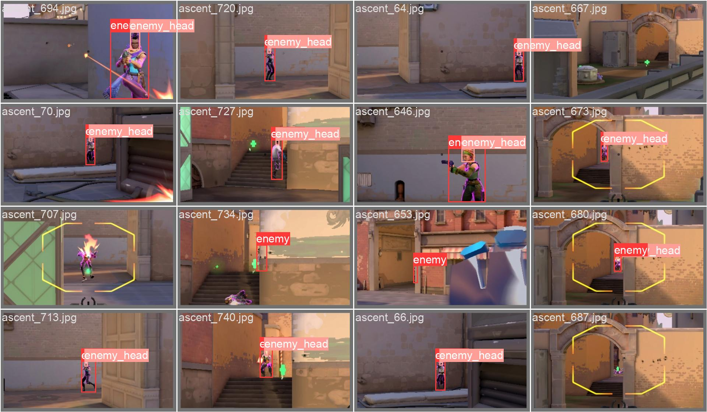
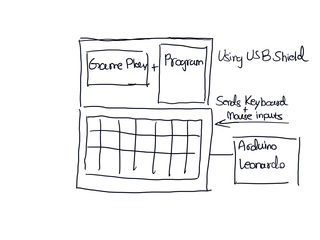
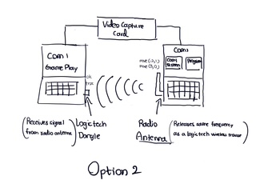

# Image Recognition FPS Agent (YOLOv5 + Arduino HID)

**UFCFXK-30-3: Digital Systems Project — UWE Bristol**
**Author:** Kaung Myat Aung
**Project Title:** Training an AI Model to play an FPS Game using Visual Reinforcement Learning

A real-time system that plays a first-person shooter from screen input alone: a custom-trained **YOLOv5 object-detection** model identifies targets on screen, and an **Arduino Leonardo** emulating a USB HID mouse converts those detections into genuine hardware input.

---

## Abstract

This project develops an AI system capable of playing a first-person shooter (FPS) game using only visual input and human-like controls, simulating a real player. A custom-trained YOLOv5 object detection model identifies in-game elements (enemies and enemy heads) in real time from screen captures. Detected target coordinates are translated into physical mouse movements via an Arduino Leonardo fitted with a USB Host Shield, so that all inputs arrive at the machine as genuine hardware signals rather than software-injected events. The long-term aim is to extend this pipeline with reinforcement learning, enabling the agent to adapt and improve its decision-making through repeated gameplay.


*The custom YOLOv5 model identifying and labelling `enemy` and `enemy_head` targets with bounding boxes in real time.*

## System Architecture

The pipeline runs as a closed loop:

1. **Screen capture** — `mss` grabs frames from the game at native resolution (1920×1080), optionally cropped to a central region to boost inference FPS.
2. **Inference** — a custom YOLOv5 model (`best.pt`), loaded locally via `torch.hub`, detects two classes: `enemy` (0) and `enemy_head` (1). CUDA acceleration is used on an Nvidia GPU for real-time performance.
3. **Targeting** — the offset between the detection's centre point and the screen centre is computed and scaled into a relative mouse movement.
4. **Hardware input** — the movement command is sent over serial (`COMx`, format `dx:dyx`) to an Arduino Leonardo, which emulates a USB HID mouse and physically moves the cursor. Large movements are chunked into ±127-pixel steps (the HID report limit).

### Hardware input designs

Two input architectures were designed and prototyped:

**Option 1 — Arduino Leonardo + USB Host Shield (implemented)**
The game PC runs both the gameplay and the detection program. The Leonardo, with a USB Host Shield attached, sits between a physical mouse and the PC. It passes through genuine mouse input while also injecting AI-generated movement commands received over serial, so all input appears to originate from real hardware.



**Option 2 — Two-computer setup with capture card and wireless spoofing (explored)**
Gameplay runs on Computer 1 while detection runs on Computer 2, which receives the video feed through a video capture card. Computer 2 transmits movement commands over a radio antenna emulating a Logitech wireless mouse transmitter, received by a Logitech dongle on Computer 1. This fully isolates the AI from the game machine.



## Repository Structure

```
├── best.pt                     # Trained YOLOv5 weights (enemy / enemy_head)
├── docs/                       # Design sketches and screenshots used in this README
├── yolov5/                     # YOLOv5 (Ultralytics) — required for local model loading
├── dataset/
│   ├── images/
│   │   ├── train/              # ~2,090 training images (frames from 7 maps)
│   │   └── val/                # ~548 validation images
│   └── labels/
│       ├── train/              # YOLO-format annotations
│       ├── val/
│       └── labels.txt          # Class names: enemy, enemy_head
└── scripts/
    ├── aimbot.py               # Main loop: capture → detect → aim via Arduino
    ├── detections.py           # Live detection viewer with bounding boxes + FPS counter
    ├── video-frames.py         # Extracts cropped frames from gameplay recordings for dataset building
    ├── movementtest.py         # Serial port discovery + manual mouse-movement testing
    └── arduino-contact/
        └── mouse.ino           # Arduino Leonardo firmware (HID mouse emulation over serial)
```

## Dataset

The dataset was built by recording gameplay footage across seven maps (Ascent, Bind, Breeze, Fracture, Haven, Icebox, Pearl), extracting every 20th frame with `video-frames.py`, cropping to the screen's central region, and manually annotating in YOLO format.

| Split | Images |
|-------|--------|
| Train | 2,090  |
| Val   | 548    |

| Class ID | Name        |
|----------|-------------|
| 0        | enemy       |
| 1        | enemy_head  |

## Requirements

**Hardware**
- Windows PC with an Nvidia GPU (CUDA support; tested with a GTX 1080 Ti class card)
- Arduino Leonardo (native USB HID support)
- USB Host Shield 2.0
- Video capture card + Logitech wireless mouse/dongle (Option 2 only)

**Software**
- Python 3.8+
- PyTorch (with CUDA), YOLOv5 dependencies
- Arduino IDE with the `Mouse` and [USB Host Shield 2.0](https://github.com/felis/USB_Host_Shield_2.0) libraries

```bash
pip install torch torchvision opencv-python mss numpy pandas keyboard pyserial
cd yolov5 && pip install -r requirements.txt
```

## Setup & Usage

1. **Flash the Arduino** — open `scripts/arduino-contact/mouse.ino` in the Arduino IDE and upload it to the Leonardo. The firmware accepts three serial commands:
   - `dx:dyx` — relative mouse move
   - `shoot` — left click
   - `silentdx:dyx` — flick to target, click, and return to origin
2. **Find the serial port** — run `python scripts/movementtest.py`, select the listed port, and confirm the cursor moves as expected.
3. **Update paths** — in `aimbot.py` and `detections.py`, set the paths to your local `yolov5/` folder and `best.pt`, and set the correct `COM` port in `aimbot.py`.
4. **Verify detection** — run `python scripts/detections.py` to view live bounding boxes and the achieved FPS. Adjust `MONITOR_SCALE` and inference `size` to balance accuracy against frame rate.
5. **Run the full pipeline** — launch the game in 1920×1080, then run `python scripts/aimbot.py`. The loop targets `enemy_head` detections above 30% confidence and sends proportional movement commands (sensitivity tuned via the `0.1` scaling factor). Press `q` to quit.

## Testing & Evaluation

Object detection accuracy was evaluated in a controlled environment by feeding the model live and recorded gameplay footage, measuring:

- **Precision** — proportion of detections that were correct
- **Recall** — proportion of true in-game elements successfully detected
- **Inference FPS** — real-time throughput at various capture-region scales and input sizes (`detections.py` reports this live)

Mouse-movement accuracy was validated separately with `movementtest.py`, confirming that serial commands produce the expected on-screen displacement, including chunked movements beyond the ±127 HID limit.

## Ethical Statement & Disclaimer

This project was undertaken **solely for academic research** as part of a university dissertation, to study real-time computer vision, human-input simulation, and the feasibility of visual reinforcement learning agents in FPS environments. All testing was performed in controlled, offline settings. Using this software in online multiplayer games violates game publishers' Terms of Service and can result in permanent account bans. It is **not** intended, and must not be used, to gain an unfair advantage in competitive online play.

## References

- Bochkovskiy, A., Wang, C.-Y. and Liao, H.-Y.M. (2020) *YOLOv4: Optimal Speed and Accuracy of Object Detection*. arXiv:2004.10934.
- Mnih, V. et al. (2015) 'Human-level control through deep reinforcement learning', *Nature*, 518, pp. 529–533.
- Ultralytics (2020) *YOLOv5*. Available at: https://github.com/ultralytics/yolov5
- River's Educational Channel (2021) *I tried to make a Valorant AI using computer vision*. [video online] Available at: https://youtu.be/LXA7zXVz8A4 [Accessed 29 January 2025].
- Will Kwan (2024) *Training AI to Play Fortnite (Reinforcement Learning + Computer Vision)*. [video online] Available at: https://youtu.be/iFAe7x2Nos8 [Accessed 29 January 2025].
- bycloud (2021) *AI Learns To Play CS:GO By Watching Humans Play!* [video online] Available at: https://youtu.be/UvoyMGxN89Y [Accessed 29 January 2025].
- apollopower (2019) *DOOM-AI (ViZDoom)*. [code repository] Available at: https://github.com/apollopower/DOOM-AI [Accessed 29 January 2025].
- Oleg Mazurov et al. *USB Host Shield Library 2.0*. Available at: https://github.com/felis/USB_Host_Shield_2.0
